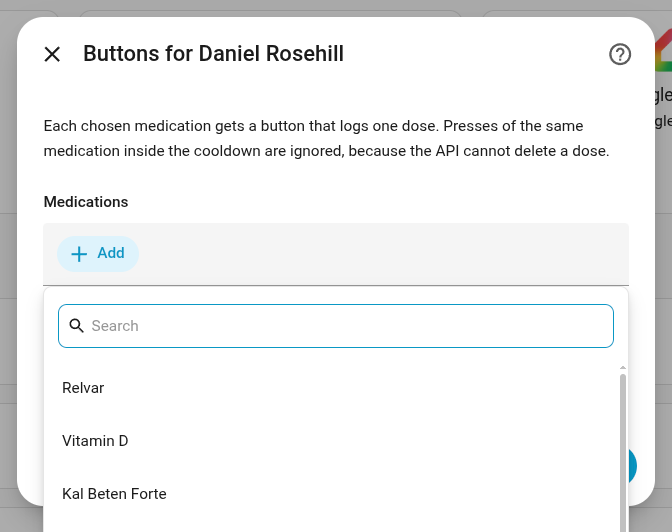
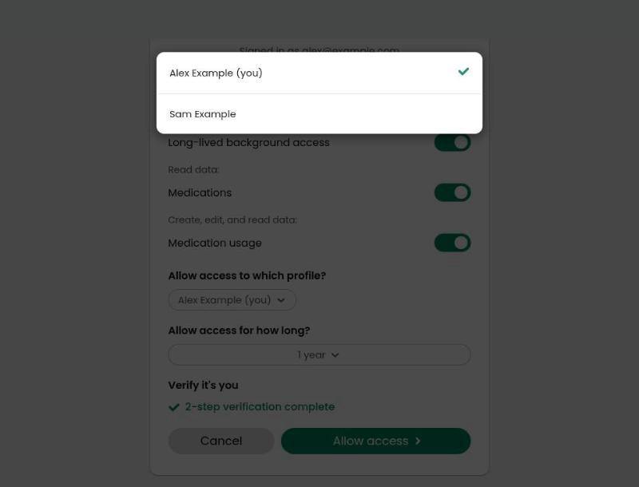
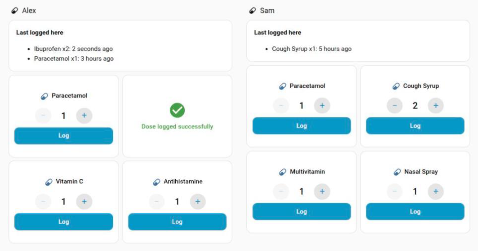
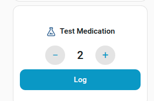
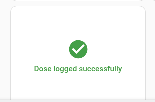

# Guava Health for Home Assistant (unofficial)

> **Unofficial.** Built by a Guava user. Not made, endorsed, maintained or supported by Guava.
> Don't contact Guava about it; open an issue here.

Log medication doses to [Guava Health](https://guavahealth.com) from Home Assistant: a button
per medication, and an action any automation can call. That makes a Zigbee remote, an NFC tag or
a voice satellite into a dose logger. One entry per person, so a parent can log for a child.

Dose logging is the point. It does not import health data into Home Assistant.



## What you get

- **Buttons:** `button.guava_<person>_log_<medication>`, one per medication you choose. Each press
  logs a quantity of 1 at the current time.
- **Action:** `guava_health.log_medication` with `medication`, and optionally `config_entry_id`
  (required with more than one person), `quantity`, `notes`, `time`, `bypass_cooldown`, `allow_new`.
- **Entity action:** `guava_health.log_dose` targets a button and takes a `quantity`. The button
  already knows the person and the exact medication name, so automations don't need either.
- **Dashboard card:** `custom:guava-dose-card`, installed with the integration. Each card has − and +
  controls starting at 1, and a **Log** button below them. Once Guava accepts the dose, the card fades,
  shows a tick and "Dose logged successfully", then resets to 1. If the dose is refused, for example
  by the cooldown, it shows the reason and keeps the quantity.
- **Attributes:** each button has `last_logged` and `last_quantity`, covering only doses Guava
  accepted through this integration. The button's own state changes on every press, even a failed one.
- **Event:** `guava_health_dose_logged` after Guava accepts a dose, for confirmation lights or
  announcements, since a Zigbee button gives no feedback of its own.

## Install

**HACS, as a custom repository.** It isn't in the default HACS store.

1. HACS → menu → **Custom repositories**.
2. Add `https://github.com/danielrosehill/Guava-HA-Integration`, type **Integration**.
3. Download **Guava Health (unofficial)**, then restart Home Assistant.

**Manually:** copy `custom_components/guava_health` into `config/custom_components/` and restart.

## Set up

1. Create your own Guava API app and key: [docs/creating-your-guava-app.md](docs/creating-your-guava-app.md).
   Everyone needs their own, because Guava issues keys per app and the key is your secret.
2. **Settings → Devices & services → Add integration → Guava Health (unofficial).**
3. Enter the client id and secret. Keep the default redirect URI if the app uses it.
4. Open the consent link, choose the person and approve. The browser lands on a `localhost` page
   that fails to load. That's expected: copy the URL from the address bar and paste it into the form
   within 10 minutes. It doesn't matter how you reach Home Assistant, because Guava never contacts it.
5. Choose which medications get buttons, and the cooldown.

The buttons and cooldown can be changed later under **Configure**.

### One entry per person

Guava grants access per person, so each patient needs their own authorisation and their own entry
under this integration. A second person doesn't need a second app, key or install:

1. Add the integration again. The key is prefilled.
2. On Guava's consent screen, choose the other person. A family-plan dependent appears there.
3. Choose that person's medications.



*Guava's consent screen, 2026-11-07. The names and email are replaced with fictional ones.*

Each person gets their own device and buttons. With more than one person, `log_medication` needs
`config_entry_id` to say whose dose it is; the action's **Person** field fills it in. Authorising the
same person twice is refused.

## Behaviour worth knowing

- **Doses can't be undone from here.** The API has no delete. A wrong dose is removed in the Guava app.
- **Cooldown:** a repeat of the same medication for the same person within the cooldown (default
  60 seconds) is refused with an error. Guava's duplicate protection can't be relied on: repeated
  identifiers were accepted twice on the sandbox (tested 2026-11-03), and it's untested on live.
  The cooldown is kept in memory, so a restart clears it. Set `bypass_cooldown` for a real second dose.
- **Names:** Guava matches on the exact name and creates a medication for a new one, and
  app-entered names can have trailing spaces (seen on live 2026-11-07). Buttons use the stored
  spelling. The action ignores case and surrounding spaces, and refuses a name that isn't an active
  medication unless `allow_new` is set, so a misheard voice command doesn't create a medication.
- **A failed press:** if Guava doesn't confirm a dose, the press shows an error and the cooldown
  isn't started. A timeout can hide a dose that did arrive, so check the app before retrying.
- **Doses logged elsewhere are invisible.** The API can't read doses back, so nothing here shows
  what was taken in the app.
- **Refresh tokens rotate.** Each one works once, so never share a grant with another client. Tokens
  are saved in Home Assistant's `.storage` directory as soon as they change. If a grant dies, Home
  Assistant asks you to authorise again.

## Dashboard card



*A dashboard with fictional names and medications, one card showing the confirmation.*

| Choose a quantity | Confirmed |
|---|---|
|  |  |

```yaml
type: custom:guava-dose-card
entity: button.guava_sam_log_paracetamol
name: Log Paracetamol   # optional
icon: mdi:pill          # optional
```

## Examples

- [Usage ideas](docs/usage-ideas.md): Zigbee remotes, NFC tags, voice.
- [`examples/`](examples/): automations to adapt.

## Status (2026-11-07)

| Check | Result |
|---|---|
| Config flow, reauth, buttons, action, cooldown, token rotation | Tested with a mocked API under Home Assistant 2026.2.3 (`tests/`) |
| Authorisation request (`/oauth/par`) with this client | Tested against Guava's sandbox |
| Live consent, token exchange and medication list through this integration | Tested on Home Assistant 2026.11.0 |
| Dose write through this integration | Tested on live through the action, for a holder and a dependent: the new medication appeared in Guava's list |
| Pressing a button on a real install | Tested on live: Guava accepted the dose |
| Dose card | Rendered on Home Assistant 2026.11.0, with the tick, error and stepper tried against a stubbed call. **A real quantity above 1 is not tested yet** |
| Loading on a real install | Tested on Home Assistant 2026.11.0: loads, and the setup form opens |
| HACS validation | Passes as a custom repository; the brands check is skipped, so it isn't ready for the default store |

## Related projects

- [Guava-Health-Plugin](https://github.com/danielrosehill/Guava-Health-Plugin): unofficial CLI, MCP
  server and agent skills for the same API, including dated
  [API notes](https://github.com/danielrosehill/Guava-Health-Plugin/blob/master/docs/api-notes.md) and
  a [DIY NFC tag guide](https://github.com/danielrosehill/Guava-Health-Plugin/blob/master/docs/nfc-tags.md).

## Development

```bash
uv sync --python 3.13
.venv/bin/pytest
```

MIT licence.
